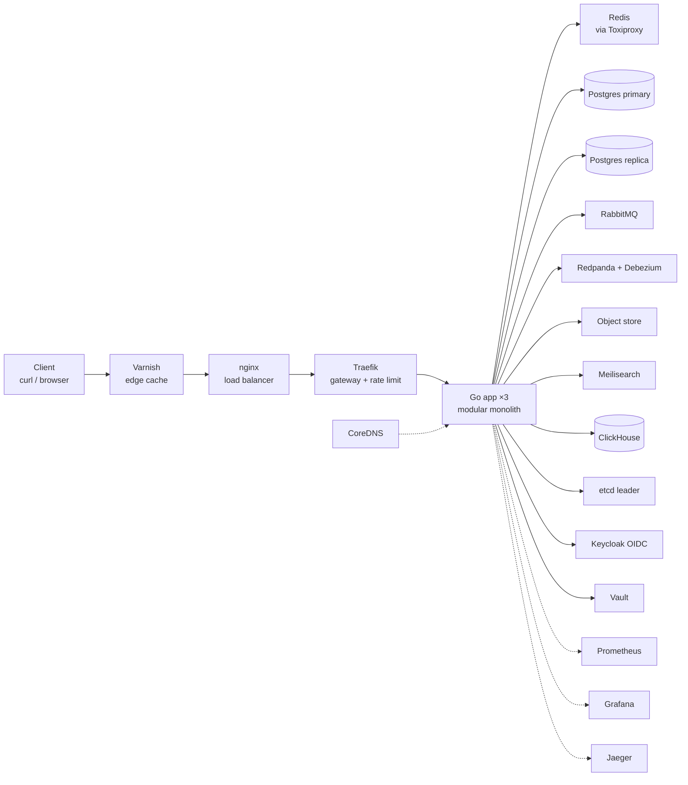
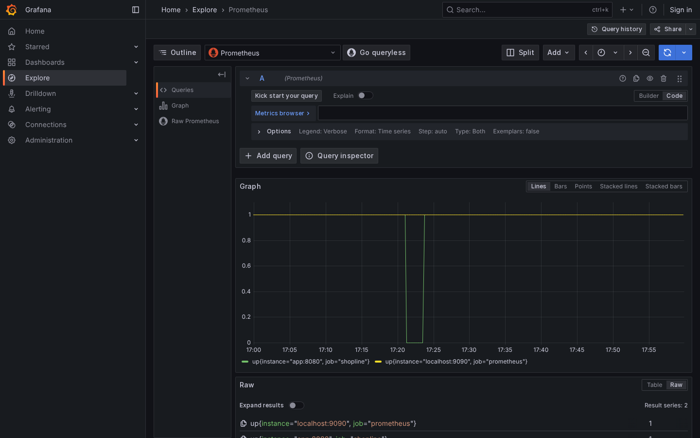
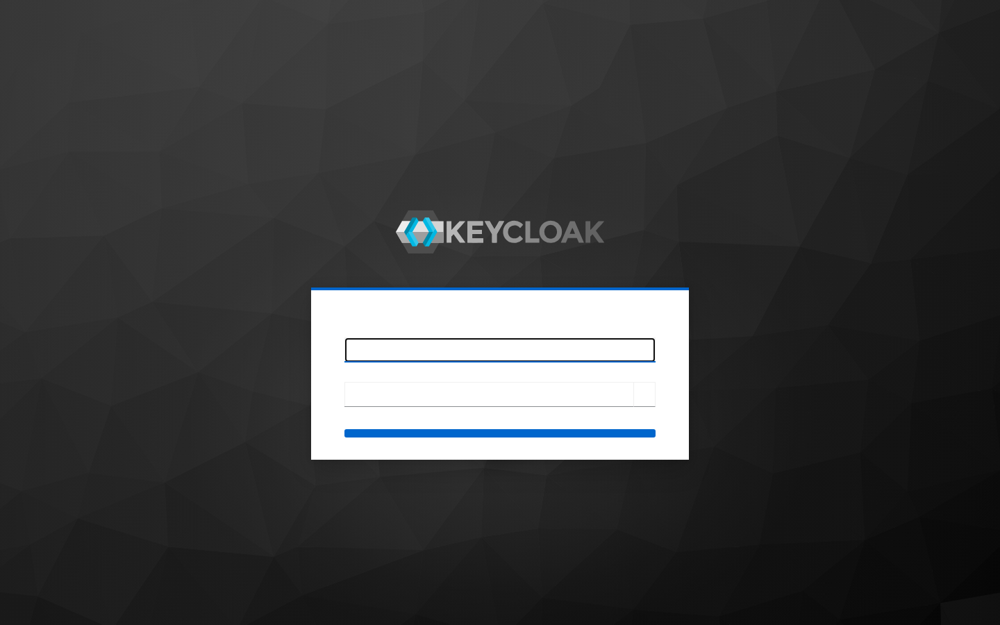
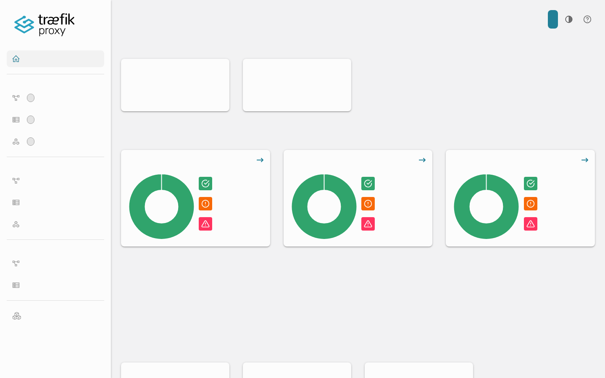
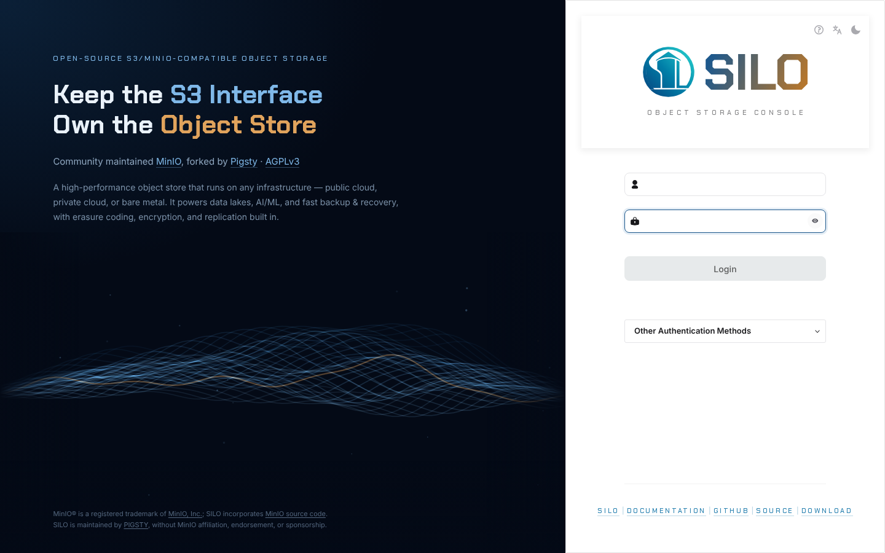
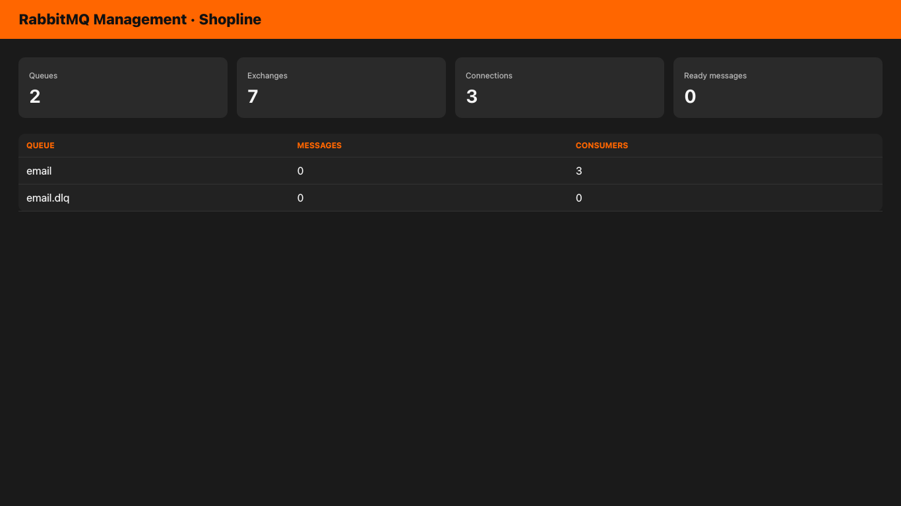
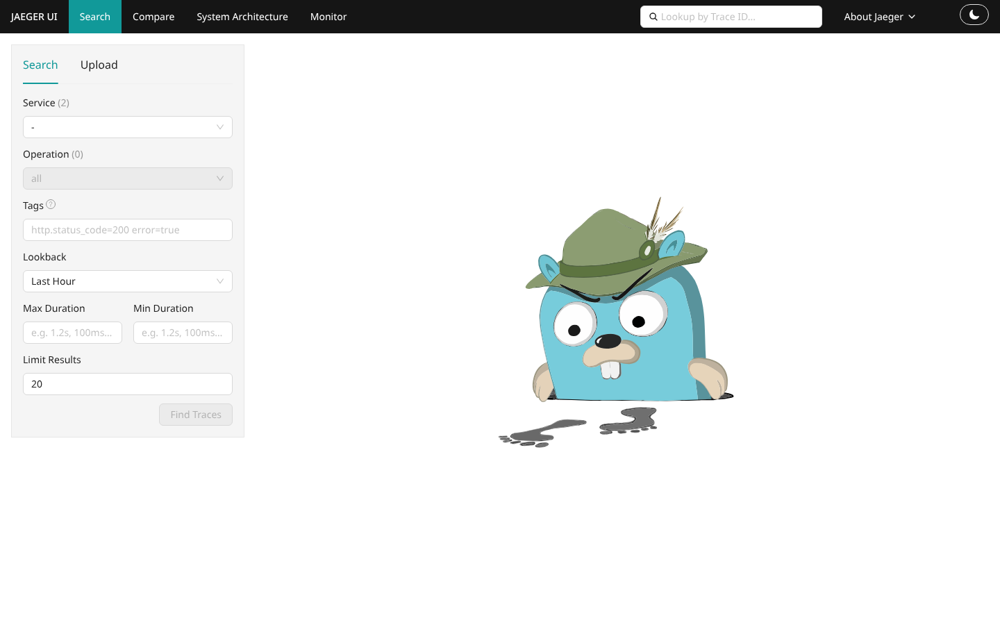

# Shopline

**System design showcase:** one Go API wired to a production-shaped platform (edge, data, messaging, search, analytics, identity, secrets, DNS, consensus, chaos, observability).

Not a toy CRUD app. Every box on a senior architecture diagram runs here and can be broken on purpose.

## Architecture



**Write path:** app → Postgres (+ outbox) → Redis DEL → RabbitMQ → ClickHouse (best-effort)

**Read path:** app → Redis (Toxiproxy) → miss → Postgres replica · Search → Meilisearch · Objects → MinIO

## Why this layout

| Choice | Why |
|--------|-----|
| Modular monolith (`cmd/shopline`) | Honest early/mid product shape; one binary, many real deps |
| `deploy/` for Compose + configs | Matches how teams separate app code from runtime wiring |
| Docs as ADRs + operating manual | Interview and on-call ready, not slideware |
| Toxiproxy in the Redis path | Chaos is a first-class demo (Shopify pattern) |

Inspired by [Google Online Boutique](https://github.com/GoogleCloudPlatform/microservices-demo) (docs + deploy story), [Shopify Toxiproxy](https://github.com/Shopify/toxiproxy), and [Go module layout](https://go.dev/doc/modules/layout).

## Quick start

**Requirements:** Docker Compose, Go 1.26+, `make`, `curl`, `python3`.

```bash
git clone https://github.com/hamidxgh/shopline.git
cd shopline
cp .env.example .env   # optional
make up                # build + start full stack
# wait until app replicas are Up (Keycloak must be ready)
make smoke             # token → order → ClickHouse prove
```

```bash
make ps      # status
make logs    # app logs
make down    # stop (keep volumes)
```

## Live stack (screenshots)

| Grafana Explore (`up`) | Keycloak admin |
|---|---|
|  |  |

| Traefik dashboard | Object storage (Silo / MinIO-compatible) |
|---|---|
|  |  |

| RabbitMQ (queues / consumers) | Jaeger UI |
|---|---|
|  |  |

## Ports

| Port | Service |
|------|---------|
| 8082 | Varnish (prefer for demos) |
| 8080 | nginx |
| 8081 | Traefik dashboard |
| 8084 | Keycloak |
| 5432 / 5433 | Postgres primary / replica |
| 8123 | ClickHouse HTTP |
| 9000 / 9001 | Object store API / console |
| 7700 | Meilisearch |
| 9090 | Prometheus |
| 3000 | Grafana (anonymous Admin) |
| 16686 | Jaeger |
| 8200 | Vault |
| 8474 | Toxiproxy API |
| 15672 | RabbitMQ management |
| 1053 | CoreDNS (host) |

## Auth (lab)

```bash
TOKEN=$(curl -sS -X POST 'http://localhost:8084/realms/shopline/protocol/openid-connect/token' \
  -H 'Content-Type: application/x-www-form-urlencoded' \
  -d 'grant_type=password&client_id=shopline-api&username=shopper&password=shopper' \
  | python3 -c 'import sys,json; print(json.load(sys.stdin)["access_token"])')

curl -sS http://localhost:8082/products/1 -H "Authorization: Bearer $TOKEN"
```

Lab user: `shopper` / `shopper` · client: `shopline-api`.

## Repository layout

```
cmd/shopline/          Go API (HTTP, workers, outbox leader, analytics)
deploy/                docker-compose + nginx, Traefik, Varnish, ...
docs/                  architecture, operating manual, ADRs, images
scripts/smoke.sh       end-to-end prove
.github/workflows/ci.yml
Makefile
```

## Stack map

| # | Concern | Tool | Production twin |
|---|---------|------|-----------------|
| 1 | Service + OLTP | Go + Postgres | managed Postgres / Aurora |
| 2 | Load balancer | nginx | AWS ALB / cloud LB |
| 3 | API gateway | Traefik | Kong / cloud API GW |
| 4 | Cache | Redis | ElastiCache / Memorystore |
| 5 | Queue + workers | RabbitMQ | SQS + workers |
| 6 | Event log | Redpanda | Apache Kafka / MSK |
| 7 | Outbox + CDC | Debezium | managed CDC |
| 8 | Object storage | Silo (S3 API) | Amazon S3 |
| 9 | CDN edge | Varnish | CloudFront / Fastly |
| 10 | Search | Meilisearch | OpenSearch / Algolia |
| 11 | Read replicas | Postgres streaming | RDS read replicas |
| 12 | Consensus | etcd | K8s lease / Consul |
| 13 | Fault injection | Toxiproxy | chaos in CI |
| 14 | Metrics / traces | Prometheus, Grafana, Jaeger | Datadog / Tempo |
| 15 | Identity + secrets | Keycloak, Vault | Auth0 + Secrets Manager |
| 16 | DNS | CoreDNS | Route53 / cluster DNS |
| 17 | Analytics | ClickHouse | ClickHouse Cloud / BigQuery |

## Chaos starter

```bash
# 800ms latency on Redis through Toxiproxy
curl -sS -X POST http://localhost:8474/proxies/redis/toxics \
  -H 'Content-Type: application/json' \
  -d '{"name":"latency","type":"latency","attributes":{"latency":800}}'

# remove
curl -sS -X DELETE http://localhost:8474/proxies/redis/toxics/latency
```

More drills: [`docs/OPERATING.md`](docs/OPERATING.md).

## Docs

- [`docs/ARCHITECTURE.md`](docs/ARCHITECTURE.md)
- [`docs/OPERATING.md`](docs/OPERATING.md)
- [`docs/adr/`](docs/adr/)
- [`CONTRIBUTING.md`](CONTRIBUTING.md)

## Design notes

- Checkout does not wait on analytics: ClickHouse insert is best-effort after Postgres commit.
- Redis sits behind Toxiproxy so latency and outages are injectable without rewriting the app.
- Circuit breakers / retry budgets are intentional next work on the dependency edges (cache, payments, OLAP), not missing by accident.

## License

MIT. Lab credentials are intentional local defaults. Do not expose this stack beyond localhost without rotating secrets.
